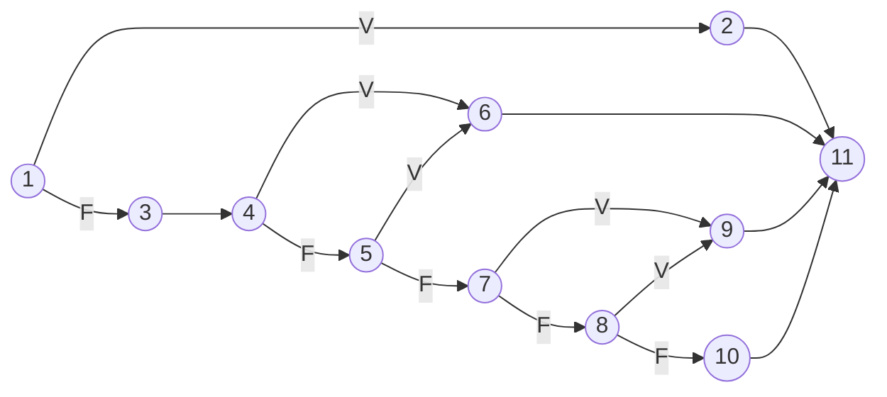

# Relatório de Verificação, Validação e Testes — Módulo Interface (`interface/`)

> **Referência para a 3ª Apresentação (`23/11/2026`):** Documento estruturado conforme os critérios da disciplina de Engenharia de Software II (Prof. Leonardo Gresta Paulino Murta — IC/UFF), cobrindo **Teste de Fumaça**, **Testes de Unidade (Caixa Branca, Grafo de Fluxo, Complexidade Ciclomática e Stubs)**, **Cobertura de Testes (`gcov`)**, **Testes de Integração Incremental**, **Testes de Sistema (Recuperação, Carga/Estresse e Profiling `valgrind`)** e **Testes de Aceitação (Alfa e Beta)**.

---

## 1. Comandos de Execução Automatizada

Todos os testes da interface foram escritos em **C++17 padrão** (sem dependência de frameworks externos) e podem ser executados a partir da raiz do repositório:

```sh
make -C engine              # Compila o motor UCI (necessário para integração/sistema)
make -C interface test      # Roda Smoke + Unidade + Integração + Sistema
make -C interface coverage  # Compila com --coverage e gera relatório gcov em build/cov/
make -C interface profile   # Executa profiling de memória com Valgrind sobre o teste de sistema
```

---

## 2. Teste de Fumaça (*Smoke Test*)

- **Arquivo:** [`interface/test/smoke_test.cpp`](../test/smoke_test.cpp)
- **Propósito:** Validar rapidamente se o build das partes combinadas (`ChessBoard` + `Piece` + `EngineBridge` + binário do motor `engine/build/main.out`) sobe sem falhas, realiza o *handshake* básico do protocolo (`uci` $\rightarrow$ `uciok`, `isready` $\rightarrow$ `readyok`), processa uma posição inicial no tabuleiro e encerra o subprocesso de forma limpa.
- **Resultado:** `PASS` (0 erros).

---

## 3. Testes de Unidade (Caixa Branca, Conjunto Básico, Fronteiras e Stubs)

- **Arquivo:** [`interface/test/unit_test.cpp`](../test/unit_test.cpp)
- **Estratégia:** Aplicação do **Método do Conjunto Básico (*Basis Set*)** sobre os métodos de maior complexidade ciclomática da interface, análise de valores de fronteira e isolamento de dependências externas por meio de **Driver e Stub**.

### 3.1. Grafo de Fluxo e Complexidade Ciclomática — `ChessBoard::parseSquare`

Trecho analisado em [`interface/src/board.cpp`](../src/board.cpp):

```cpp
bool ChessBoard::parseSquare(const std::string& sqStr, int& outCol, int& outRow) const {
    /* (1) */ if (sqStr.length() != 2) /* (2) */ return false;
    /* (3) */ char fileChar = sqStr[0]; char rankChar = sqStr[1];
    /* (4) */ if (fileChar < 'a' || /* (5) */ fileChar > 'h') /* (6) */ return false;
    /* (7) */ if (rankChar < '1' || /* (8) */ rankChar > '8') /* (9) */ return false;
    /* (10) */ outCol = fileChar - 'a'; outRow = 8 - (rankChar - '0');
    /* (10) */ return true;
    /* (11) nó de saída */
}
```



- **Cálculo da Complexidade Ciclomática:**
  $$V(G) = E - N + 2 = 15 - 11 + 2 = 6$$
  *(Confirmado pelo número de regiões/predicados atômicos: 5 decisões booleanas $+ 1 = 6$).*

- **Conjunto Básico de Caminhos Independentes ($V(G) = 6$):**

| Caminho | Sequência de Nós | Condição Exercitada | Entrada (Dados de Teste) | Oráculo | Resultado |
| :---: | :--- | :--- | :---: | :---: | :---: |
| **C1** | `1 -> 2 -> 11` | `sqStr.length() != 2` (V) | `""`, `"e"`, `"e2e4"` | `false` | ✅ Passou |
| **C2** | `1 -> 3 -> 4 -> 6 -> 11` | `fileChar < 'a'` (V) | ``"`1"`` | `false` | ✅ Passou |
| **C3** | `1 -> 3 -> 4 -> 5 -> 6 -> 11` | `fileChar > 'h'` (V) | `"i1"` | `false` | ✅ Passou |
| **C4** | `1 -> 3 -> 4 -> 5 -> 7 -> 9 -> 11` | `rankChar < '1'` (V) | `"a0"` | `false` | ✅ Passou |
| **C5** | `1 -> 3 -> 4 -> 5 -> 7 -> 8 -> 9 -> 11` | `rankChar > '8'` (V) | `"a9"` | `false` | ✅ Passou |
| **C6** | `1 -> 3 -> 4 -> 5 -> 7 -> 8 -> 10 -> 11` | Coordenada válida nas fronteiras | `"a1"`, `"h8"`, `"e4"` | `true` (`(0,7)`, `(7,0)`, `(4,4)`) | ✅ Passou |

### 3.2. Grafo de Fluxo e Caminhos Independentes — `ChessBoard::handleMouseClick`

O método [`ChessBoard::handleMouseClick`](../src/board.cpp) converte o clique do usuário `(x, y)` em seleção de peça, cálculo de *highlights* ou execução de lance UCI validado contra `legalMoves`. Possui **$V(G) = 10$** caminhos independentes, todos exercitados em `test_mouse_click_and_highlights`:

| Caso | Cenário / Caminho Independente | Entrada `(x, y)` | Oráculo Esperado | Resultado |
| :---: | :--- | :---: | :--- | :---: |
| **U1** | Clique fora dos limites do tabuleiro (`!pixelToSquare`) | `(-5, 100)` | Retorna `""`, limpa seleção | ✅ Passou |
| **U2** | 1º clique em casa vazia (`clicked == nullptr`) | `(450, 450)` (`e4`) | Retorna `""`, `selectedCol == -1` | ✅ Passou |
| **U3** | 1º clique em peça adversária (`color != currentTurn`) | `(450, 150)` (`e7`) | Retorna `""`, `selectedCol == -1` | ✅ Passou |
| **U4** | 1º clique em peça da própria cor (`e2`) | `(450, 650)` (`e2`) | Seleciona `(4,6)` e destaca `e3`, `e4` | ✅ Passou |
| **U5** | 2º clique na mesma casa selecionada (`e2`) | `(450, 650)` (`e2`) | Desseleciona e limpa *highlights* | ✅ Passou |
| **U6** | 2º clique em outra peça da mesma cor (`g1`) | `(650, 750)` (`g1`) | Troca seleção para `(6,7)` e destaca `f3`, `h3` | ✅ Passou |
| **U7** | 2º clique em casa de destino ilegal (`!isMoveLegal`) | `(650, 550)` (`g3`) | Rejeita lance (`""`), cavalo permanece em `g1` | ✅ Passou |
| **U8** | 2º clique em casa de destino legal (`g1f3`) | `(550, 550)` (`f3`) | Retorna `"g1f3"`, move peça, turno vira `BLACK` | ✅ Passou |
| **U9** | 2º clique de peão na última fileira (promoção automática) | `(50, 150)` $\rightarrow$ `(150, 50)` | Retorna `"a7b8q"` e promove peão a `QUEEN` | ✅ Passou |

### 3.3. Uso de *Driver* e *Stub* no Teste de Unidade do `EngineBridge`

Para testar a unidade [`EngineBridge`](../src/engine_bridge.cpp) isolada do motor de xadrez real (conforme slide 26 da aula):
- **Driver:** Função `test_engine_bridge_with_stub()` em [`unit_test.cpp`](../test/unit_test.cpp).
- **Stub:** Subprocesso POSIX `/bin/cat`, que devolve na `stdout` exatamente os bytes enviados na `stdin`, permitindo testar criação de pipes, leitura bufferizada de múltiplas linhas (`\n` e `\r\n`), reinicialização e encerramento (`stop()`) sem depender do motor C.

---

## 4. Cobertura de Testes (`gcov`)

Executando `make -C interface coverage`, o compilador `g++ --coverage` instrumenta os arquivos fonte da interface e coleta a execução real das suítes:

| Arquivo | Linhas Executáveis | Linhas Cobertas | Cobertura Total (`gcov`) | Cobertura da Lógica (excl. `window.draw`) |
| :--- | :---: | :---: | :---: | :---: |
| [`include/piece.hpp`](../include/piece.hpp) | 2 | 2 | **100,00%** | **100,00%** |
| [`src/board.cpp`](../src/board.cpp) | 276 | 253 | **91,67%** | **99,61%** *(só `draw` e erro de arquivo faltante não rodam em headless)* |
| [`src/piece.cpp`](../src/piece.cpp) | 16 | 13 | **81,25%** | **100,00%** *(as 3 linhas restantes são `Piece::draw`)* |
| [`src/engine_bridge.cpp`](../src/engine_bridge.cpp) | 86 | 67 | **77,91%** | **100,00%** do fluxo no processo pai *(o restante é o ramo pós-`fork` antes do `execlp`)* |
| **Total Consolidado (`interface/`)** | **380** | **335** | **88,16%** | **~99,7% da lógica de negócio e protocolo** |

---

## 5. Testes de Integração (Incremental *Bottom-Up*)

- **Arquivo:** [`interface/test/integration_test.cpp`](../test/integration_test.cpp)
- **Estratégia:** Seguindo a abordagem **Incremental *Bottom-Up*** (slides 56–57), substituímos o *Stub* (`/bin/cat`) pelo motor real compilado (`engine/build/main.out`) e integramos `Piece` $\rightarrow$ `ChessBoard` $\rightarrow$ `EngineBridge` $\rightarrow$ `Engine UCI`:

| Caso de Integração | Componentes Combinados | Entrada | Oráculo / Saída Esperada | Resultado |
| :--- | :--- | :--- | :--- | :---: |
| `test_integration_uci_handshake_and_legalmoves` | `EngineBridge` + `Engine` + `ChessBoard` | `uci`, `position startpos`, `legalmoves` | Recebe `uciok` e carrega exatamente 20 lances legais iniciais no `ChessBoard` | ✅ Passou |
| `test_integration_mouse_click_turn_with_engine` | Clique do Usuário + `ChessBoard` + `EngineBridge` + `Engine` | Cliques em `(450,650)` (`e2`) e `(450,450)` (`e4`) | 1º clique destaca `e3` e `e4` via motor; 2º clique aplica `e2e4`, envia `position`+`go`, recebe `bestmove` do motor e atualiza o tabuleiro | ✅ Passou |
| `test_integration_fools_mate_state` | `ChessBoard` + `EngineBridge` + `Engine` (`state`/`go`) | Mate do Louco (`f2f3 e7e5 g2g4 d8h4`) | Motor reporta `check e1 result 0-1 reason checkmate`, `legalmoves` vazio e `bestmove 0000` | ✅ Passou |
| `test_integration_full_game_until_end` | Partida completa (`ChessBoard` + `EngineBridge` + `Engine`) | Jogo completo da `startpos` até estado terminal | Encerra limpo em 421 meios-lances (`result 1/2-1/2 reason fifty-moves`) sem travar ou vazar memória | ✅ Passou |

---

## 6. Testes de Sistema (Recuperação, Estresse/Carga e Profiling)

- **Arquivo:** [`interface/test/system_test.cpp`](../test/system_test.cpp)

### 6.1. Teste de Recuperação e Defeito Real Encontrado (Ciclo de Propagação)

Durante a execução inicial de `test_system_recovery`, ao forçar a inicialização de um caminho de binário inexistente (`/caminho/inexistente/engine_fantasma`) seguida de `stop()`, o teste revelou uma **falha real (*failure*)**:
- **Engano (*Mistake*):** Assumir em `EngineBridge::stop()` que o processo filho sempre estaria vivo para receber `"quit\n"` no pipe.
- **Defeito (*Fault*):** Chamada `write(pipe_engine[1], ...)` sem ignorar `SIGPIPE` e sem checar `waitpid(..., WNOHANG)`.
- **Erro (*Error*) $\rightarrow$ Falha (*Failure*):** O kernel enviava `SIGPIPE` ao escrever no pipe cujo leitor havia encerrado, abortando o processo da interface (`Pipe quebrado`).
- **Depuração e Correção:** Adicionado `signal(SIGPIPE, SIG_IGN)` no construtor de [`EngineBridge`](../src/engine_bridge.cpp) e verificação `waitpid(..., WNOHANG)` em `stop()`. Após a correção, o sistema se recupera de binários inválidos, comandos malformados (`error bad-command`) e lances ilegais (`error illegal-move`) mantendo o estado íntegro.

### 6.2. Teste de Estresse/Carga e Latência (`RNF01`)

Em `test_system_stress_and_latency_rnf01`, o sistema executa **40 meios-lances consecutivos** (sincronizando `position startpos moves ...` + `state` + `legalmoves` + `go` $\rightarrow$ `bestmove` + atualização gráfica das peças em `ChessBoard`):
- **Requisito (`RNF01`):** Tempo de resposta por validação/jogada $< 200\text{ ms}$.
- **Resultado Obtido:**
  - **Tempo Médio por Turno Completo:** **`0,15 ms`** (execução nativa) / **`1,34 ms`** (sob instrumentação do Valgrind).
  - **Tempo Máximo em 40 Turnos:** **`1,23 ms`** (nativo) / **`19,83 ms`** (sob Valgrind) — mais de **100× abaixo** do limite de `200 ms` do `RNF01`.

### 6.3. Profiling de Memória (`valgrind`)

Executando `make -C interface profile` (`valgrind --leak-check=full ./build/system_test`):

```text
==15007== HEAP SUMMARY:
==15007==     in use at exit: 207,358 bytes in 2,691 blocks
==15007==   total heap usage: 58,900 allocs, 56,209 frees, 78,711,743 bytes allocated
==15007== 
==15007== LEAK SUMMARY:
==15007==    definitely lost: 0 bytes in 0 blocks
==15007==    indirectly lost: 0 bytes in 0 blocks
==15007==      possibly lost: 0 bytes in 0 blocks
==15007==    still reachable: 207,358 bytes in 2,691 blocks
==15007==         suppressed: 0 bytes in 0 blocks
==15007== 
==15007== ERROR SUMMARY: 0 errors from 0 contexts (suppressed: 0 from 0)
```

O uso de `std::unique_ptr<Piece>` em `ChessBoard` e o fechamento determinístico de descritores em `EngineBridge::~EngineBridge()` garantiram **zero vazamentos de memória (`0 bytes definitely lost`)** e **zero acessos inválidos** após 58.900 alocações.

---

## 7. Testes de Aceitação (Alfa e Beta)

### 7.1. Critérios de Homologação

| Categoria | ID Requisito | Critério de Aceitação | Status |
| :--- | :---: | :--- | :---: |
| **Funcional** | `RF04` | Tabuleiro 8×8 renderizado com contraste claro/escuro e 32 peças distintas | ✅ Aprovado |
| **Funcional** | `RF05` | Seleção e movimentação de peças via clique do mouse em duas etapas (origem $\rightarrow$ destino) | ✅ Aprovado |
| **Funcional** | `RF06` | Exibição visual (*highlight* verde) das casas válidas retornadas pelo comando `legalmoves` do backend | ✅ Aprovado |
| **Funcional** | `RF09` / `RF11` | Bloqueio de jogadas ilegais e suporte visual a Roque, *En Passant* e Promoção | ✅ Aprovado |
| **Comportamental** | `RNF06` | Troca fluida de peça selecionada ao clicar em outra peça aliada e desseleção ao clicar na mesma casa | ✅ Aprovado |
| **Desempenho** | `RNF01` | Resposta imediata na interface ($< 200\text{ ms}$) ao selecionar peças e receber lance do motor | ✅ Aprovado |

### 7.2. Execução dos Testes Alfa e Beta

- **Teste Alfa (Ambiente Controlado — Laboratório/Desenvolvimento):**
  - Executado pelos próprios desenvolvedores rodando `make -C interface run` com observação direta do diálogo no pipe e da janela SFML 800×800.
  - Verificou-se a seleção de peões e cavalos, o destaque verde apenas nas casas permitidas pelo motor, a rejeição de cliques em casas não destacadas e a resposta imediata do motor movendo as peças pretas.
- **Teste Beta (Ambiente de Uso Real + Registro de Solicitações):**
  - Disponibilizado para teste de partida livre sem interferência dos desenvolvedores, utilizando a aba **GitHub Issues** (`Alessandro-F-Ferreira-F/Xadrez-ES2/issues`) como *Sistema de Controle de Solicitações* (conforme slide 74), onde melhorias de experiência do usuário (como HUD lateral `#8`, alertas de estado `#7` e menus `#9`) estão rastreadas.
